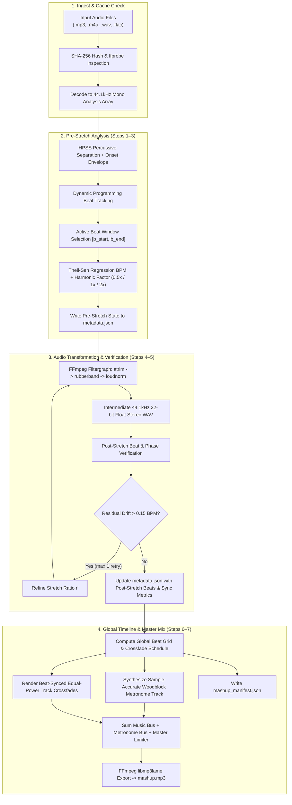

# 01 — System Overview & Architecture

## 1. Purpose & Scope
**Running Tracks Mixer (`rtmix`)** is a backend Python audio processing pipeline that transforms a directory of heterogeneous audio tracks (`.mp3`, `.m4a`, `.flac`, `.wav`, `.ogg`) into a single continuous, tempo-locked `.mp3` mashup overlaid on a sample-accurate metronome backing track for running cadence training.

### Core Goals
1. **Rhythmic Purity**: Strip non-music intros/outros (silence, ambient swells, beatless spoken intros/outros) and snap track start/end boundaries to exact musical beats.
2. **Harmonic Tempo Locking**: Match each track to the nearest harmonic factor ($k \in \{0.5, 1.0, 2.0\}$) of the runner's target cadence (`target_bpm`), avoiding unnatural pitch/timbre distortion when a track is naturally half-time or double-time.
3. **Sub-10ms Phase Alignment**: Eliminate MP3 encoder padding shifts, `librosa` hop-quantization tempo drift, and loop rounding accumulation so every musical beat locks tightly to the metronome clicks from start to finish.
4. **Uniform Loudness & Seamless Transitions**: Normalize track loudness (EBU R128) and join consecutive songs using beat-synchronized equal-power crossfades.
5. **Auditability & Idempotency**: Persist detailed per-track JSON metadata (pre-stretch and post-stretch) and a global mashup manifest. Cache intermediate work products by content hash + parameters.

---

## 2. High-Level Pipeline Architecture



---

## 3. Technology Stack & System Dependencies

### System Binaries
- **`ffmpeg` & `ffprobe` ($\ge 6.0$)**: Compiled with `--enable-librubberband` and `--enable-libmp3lame`.
  - Used for container decoding, `atrim`, pitch-preserving time-stretching (`rubberband` filter), EBU R128 loudness normalization (`loudnorm`), and final `.mp3` encoding.
- **`uv`**: Mandatory Python environment and package manager.

### Python Runtime & Libraries
- **Python**: `>=3.12` (managed via `uv`).
- **`numpy` (`>=2.0`)**: Vectorized sample buffer manipulation, metronome click synthesis, equal-power crossfade envelopes, and master bus summing.
- **`scipy` (`>=1.13`)**: `scipy.stats.theilslopes` for outlier-robust linear regression of beat timestamps; signal windowing and peak refinement.
- **`librosa` (`>=0.10.2`)**: Harmonic-Percussive Source Separation (`librosa.effects.hpss`), onset strength envelope (`librosa.onset.onset_strength`), and beat tracking (`librosa.beat.beat_track`).
- **`soundfile` (`>=0.12`)**: Fast reading/writing of 32-bit float PCM `.wav` intermediates via `libsndfile`.

> [!NOTE]
> **Why no `pydub` or `moviepy`?**
> Standard `numpy` arrays + `soundfile` + direct `subprocess` calls to `ffmpeg` require fewer dependencies, avoid 16-bit integer truncation during mixing, and allow exact sample-index placement without millisecond rounding errors.

---

## 4. Workspace & Directory Layout

```text
running-tracks-mixer/
├── pyproject.toml
├── uv.lock
├── specs/
│   ├── 01-overview-and-architecture.md
│   ├── 02-audio-dsp-pipeline.md
│   └── 03-data-schemas-and-cli.md
├── src/
│   └── rtmix/
│       ├── __init__.py
│       ├── cli.py              # CLI entrypoint & argument parsing
│       ├── models.py           # Dataclasses / JSON serialization schemas
│       ├── analyzer.py         # Beat detection, HPSS windowing, Theil-Sen BPM
│       ├── processor.py        # FFmpeg trim + rubberband + loudnorm + verification
│       ├── metronome.py        # Sample-accurate click synthesis
│       ├── mixer.py            # Global beat grid scheduling & crossfade assembly
│       └── pipeline.py         # Orchestrator & caching logic
├── work/                       # Intermediate build cache (gitignored)
│   └── <track_slug>_<hash8>/
│       ├── metadata.json       # Per-track pre/post stretch metadata
│       └── stretched.wav       # Trimmed, stretched, normalized 44.1kHz float32 WAV
└── output/                     # Default output directory (gitignored)
    ├── mashup.mp3              # Final master audio
    └── mashup_manifest.json    # Complete cue sheet & sync diagnostics
```

---

## 5. Audio Format Standards Across Pipeline Stages

To prevent cumulative quantization noise, clipping, and MP3 encoder priming delay (`576–1152` silent samples added per MP3 encode), the pipeline enforces strict internal audio standards:

| Pipeline Stage | Sample Rate ($f_s$) | Channels | Sample Format | Container |
| :--- | :--- | :--- | :--- | :--- |
| **Analysis (Stage 2 & 4)** | `44,100 Hz` | `1 (Mono)` | `float32` (`[-1.0, 1.0]`) | In-memory `numpy.ndarray` |
| **Intermediate Stretched Track** | `44,100 Hz` | `2 (Stereo)` | `PCM float32` (`pcm_f32le`) | `.wav` (`work/<id>/stretched.wav`) |
| **Master Mix & Metronome Bus** | `44,100 Hz` | `2 (Stereo)` | `float32` (`[-1.0, 1.0]`) | In-memory / streamed `.wav` |
| **Final Deliverable** | `44,100 Hz` | `2 (Stereo)` | MP3 (`libmp3lame`, `-b:a 192k` or `-q:a 2`) | `.mp3` (`output/mashup.mp3`) |

---

## 6. Idempotency & Caching Strategy
Each input track is assigned a deterministic cache key:
$$\text{cache\_key} = \text{SHA256}(\text{file\_bytes})[:8] + \text{"\_"} + \text{target\_bpm}$$
If `work/<track_slug>_<cache_key>/metadata.json` and `stretched.wav` already exist and `metadata.status == "verified"`, Stages 1–4 are skipped for that track, allowing instant re-mixing when tweaking crossfade length, track order, or metronome volume.
