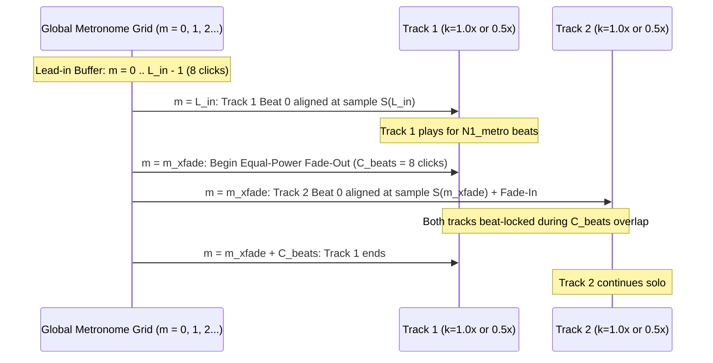

# 02 — Audio & DSP Pipeline Specification

## 1. Constants & Default Parameters

| Symbol | Parameter Name | Default Value | Description |
| :--- | :--- | :--- | :--- |
| $f_s$ | `sample_rate` | `44100` Hz | Pipeline-wide audio sample rate |
| $H$ | `hop_length` | `512` samples | STFT hop length for beat analysis (~11.6 ms resolution) |
| $B_{\text{target}}$ | `target_bpm` | `180.0` BPM | Runner's target step cadence in beats (steps) per minute |
| $K$ | `harmonic_factors` | `[0.5, 1.0, 2.0]` | Binary song-to-metronome tempo ratios |
| $[r_{\min}, r_{\max}]$ | `min_stretch`, `max_stretch` | `[0.85, 1.35]` | Allowed stretch ratio range before skipping dead-zone tracks |
| $\Delta_{\text{preroll}}$ | `preroll_sec` | `0.015` s (`15 ms`) | Safety margin preserved before first beat transient during trimming |
| $\epsilon_{\text{bpm}}$ | `bpm_tolerance` | `0.80` BPM | Max allowed post-stretch BPM deviation before micro-correction |
| $C_{\text{beats}}$ | `crossfade_beats` | `8` metronome beats | Overlap duration between consecutive tracks (must be even) |
| $L_{\text{in}}$ | `lead_in_beats` | `8` metronome beats | Solo metronome clicks before Track 1 Beat 0 |
| $L_{\text{out}}$ | `lead_out_beats` | `8` metronome beats | Solo metronome clicks after final track ends |
| $G_{\text{metro}}$ | `metronome_gain_db` | `-6.0` dBFS | Peak level of synthesized metronome clicks |
| $I_{\text{target}}$ | `loudness_lufs` | `-14.0` LUFS | Target integrated loudness per track (EBU R128) |

---

## 2. Stage-by-Stage DSP Specification

### Stage 1: Audio Decoding & Conditioning
1. Decode input file to mono `float32` at $f_s = 44100\text{ Hz}$ for analysis (via `soundfile` or `ffmpeg -i <input> -f f32le -ac 1 -ar 44100 -`).
2. Reject files shorter than `15.0` seconds with a structured validation error.

---

### Stage 2: Beat Tracking & Active Music Window Detection (Steps 1 & 2)

#### 2.1 Harmonic-Percussive Separation & Onset Envelope
To prevent ambient synth pads, vocal acapellas, or spoken-word intros from confusing the beat tracker or being included in the running mix:
1. Compute the percussive component $y_{\text{perc}}$ using Harmonic-Percussive Source Separation:
   ```python
   _, y_perc = librosa.effects.hpss(y, margin=2.0)
   ```
2. Compute the percussive onset strength envelope $O(t)$ at hop length $H = 512$:
   ```python
   onset_env = librosa.onset.onset_strength(y=y_perc, sr=44100, hop_length=512)
   ```
3. Run dynamic programming beat tracking on `onset_env`:
   ```python
   tempo_est, beat_frames = librosa.beat.beat_track(
       onset_envelope=onset_env, sr=44100, hop_length=512, tightness=100
   )
   beat_times = librosa.frames_to_time(beat_frames, sr=44100, hop_length=512)
   ```

#### 2.2 Local Onset Peak Refinement
Because `beat_frames` are quantized to $512 / 44100 \approx 11.6\text{ ms}$ frames, refine each beat timestamp $b_i$ by searching within $\pm 2$ frames ($\pm 23\text{ ms}$) for the local maximum of a fine-resolution onset envelope ($H_{\text{fine}} = 128$, ~2.9 ms resolution).

#### 2.3 Stripping Non-Music Pre- and Post-Segments
Given refined beat timestamps $B = [b_0, b_1, \dots, b_{M-1}]$:
1. **Beat-Local Percussive Energy**: For each beat interval $[b_i, b_{i+1}]$, compute the RMS energy $E_i$ of $y_{\text{perc}}$ and the peak onset strength $P_i$.
2. **Inter-Beat Interval (IBI) Stability**: Compute $\Delta b_i = b_{i+1} - b_i$, and let $\tilde{\Delta b} = \text{median}_{i \in [25\%, 75\%]}(\Delta b_i)$ be the core median beat period from the middle 50% of the song.
3. A beat $b_i$ is classified as **rhythmically active** if:
   - $E_i \ge 0.15 \cdot \text{median}(E)$ (at least $-16.5\text{ dB}$ relative to median percussive RMS), AND
   - $\left|\frac{\Delta b_i - \tilde{\Delta b}}{\tilde{\Delta b}}\right| \le 0.12$ (beat interval within $\pm 12\%$ of core tempo).
4. **Window Selection (`[b_start, b_end]`)**:
   - Scan from the beginning to find the first index $i_{\text{start}}$ where at least `8` consecutive beats are rhythmically active. Set $b_{\text{start}} = b_{i_{\text{start}}}$.
   - Scan backwards from the end to find the last index $i_{\text{end}}$ where `8` consecutive beats leading up to $i_{\text{end}}$ are rhythmically active. Set $b_{\text{end}} = b_{i_{\text{end}}}$.
   - **Total Beat Count Adjustments**: Ensure the active beat count $N_{\text{beats}} = i_{\text{end}} - i_{\text{start}}$ is a multiple of `4` (snapping $i_{\text{end}}$ down by $N_{\text{beats}} \bmod 4$ beats so the cropped phrase has complete 4-beat bars).
5. **Exact Trim Coordinates**:
   - $\text{trim\_start\_sec} = \max(0.0, b_{\text{start}} - \Delta_{\text{preroll}})$
   - $\text{trim\_end\_sec} = b_{\text{end}}$
   - Preserving $\Delta_{\text{preroll}} = 0.015\text{ s}$ ensures the attack transient of Beat 0 is never clipped, and places Beat 0 of the trimmed track at a known coordinate $\approx \Delta_{\text{preroll}}$.

---

### Stage 3: High-Precision BPM Regression & Harmonic Factor Selection (Steps 2 & 3)

#### 3.1 Theil-Sen Robust Linear Regression BPM
Using the active beats $\{b_i\}_{i = i_{\text{start}}}^{i_{\text{end}}}$, define relative beat index $k = 0, 1, \dots, N_{\text{beats}}$ and fit:
$$t(k) = m \cdot k + c$$
using `scipy.stats.theilslopes(beat_times_active, np.arange(len(beat_times_active)))`.
- The robust beat period is $T_{\text{native}} = m$ (seconds per beat).
- The native BPM is:
  $$B_{\text{native}} = \frac{60.0}{T_{\text{native}}}$$

#### 3.2 Harmonic Target Selection
Given the runner's target cadence $B_{\text{target}}$ (e.g. `170.0 BPM`) and allowed harmonic factors $K = \{0.5, 1.0, 2.0\}$:
1. Evaluate candidate song targets $B_{\text{cand}}(k) = k \cdot B_{\text{target}}$ for each $k \in K$.
2. Choose $k^*$ that minimizes logarithmic tempo stretch distance:
   $$k^* = \arg\min_{k \in K} \left| \log_2 \left( \frac{k \cdot B_{\text{target}}}{B_{\text{native}}} \right) \right|$$
3. Set track target BPM:
   $$B_{\text{track\_target}} = k^* \cdot B_{\text{target}}$$
4. Compute required time-stretch tempo multiplier:
   $$r = \frac{B_{\text{track\_target}}}{B_{\text{native}}}$$
   *(where $r > 1.0$ speeds up the track and reduces duration by $1/r$, and $r < 1.0$ slows it down).*
5. Persist pre-stretch analysis to `work/<track_id>/metadata.json`.

---

### Stage 4: FFmpeg Trim, Time-Stretch & Loudness Normalization (Step 4)

Execute a single lossless intermediate FFmpeg pipeline from the source audio file to `work/<track_id>/stretched.wav`:

```bash
ffmpeg -y -i "<input_path>" \
  -af "atrim=start=<trim_start_sec>:end=<trim_end_sec>,asetpts=PTS-STARTPTS,rubberband=tempo=<r>:transients=crisp:detector=compound:phase=laminar,loudnorm=I=-14.0:TP=-1.5:LRA=11.0" \
  -ar 44100 -ac 2 -c:a pcm_f32le \
  "work/<track_id>/stretched.wav"
```

#### Filter Chain Details
1. `atrim=start=...:end=...` + `asetpts=PTS-STARTPTS`: Slices the exact active beat window prior to time-stretching (saving CPU time on trimmed intros/outros).
2. `rubberband=tempo=<r>:transients=crisp:detector=compound:phase=laminar`: High-grade phase-vocoder time-stretching that preserves pitch and sharp drum transients.
3. `loudnorm=I=-14.0:TP=-1.5:LRA=11.0`: Normalizes integrated loudness to `-14 LUFS` with `-1.5 dBTP` true-peak ceiling so every song sits at a consistent level under the metronome.

---

### Stage 5: Post-Stretch Verification & Micro-Correction (Step 5)

Load `work/<track_id>/stretched.wav` and re-run beat detection + Theil-Sen regression:
1. Measure achieved BPM $B_{\text{achieved}} = 60.0 / m_{\text{post}}$.
2. **Tolerance Check**:
   - If $|B_{\text{achieved}} - B_{\text{track\_target}}| > \epsilon_{\text{bpm}}$ (`0.15 BPM`), refine the stretch multiplier:
     $$r' = r \cdot \frac{B_{\text{track\_target}}}{B_{\text{achieved}}}$$
     and re-run Stage 4 once with $r'$.
3. **Phase Anchor (`first_beat_sec`) & Grid Error Metrics**:
   - Expected beat period in the stretched track:
     $$T_{\text{expected}} = \frac{60.0}{B_{\text{track\_target}}}$$
   - Given post-stretch detected beats $\{t'_0, t'_1, \dots, t'_{M'-1}\}$, solve for the optimal global phase anchor $\hat{t}_0 \in [0, T_{\text{expected}})$ that minimizes median absolute deviation against the ideal beat grid:
     $$\hat{t}_0 = \text{median}_j \left( (t'_j - \text{round}((t'_j - t'_0) / T_{\text{expected}}) \cdot T_{\text{expected}}) \right)$$
   - Compute phase error for each detected beat $j$:
     $$e_j = t'_j - (\hat{t}_0 + j \cdot T_{\text{expected}})$$
   - Record `first_beat_sec` ($\hat{t}_0$), `mean_abs_phase_error_ms`, and `max_abs_phase_error_ms` in `metadata.json`.

---

### Stage 6: Sample-Accurate Metronome Synthesis (Step 6)

#### 6.1 Click Sound Synthesis (Parametric Woodblock)
Generate a single mono/stereo click kernel $w[n]$ of duration $D_{\text{click}} = 0.025\text{ s}$ ($1102$ samples at $44.1\text{ kHz}$):
- Pitch-drop sine burst from $f_{\text{start}} = 1400\text{ Hz}$ to $f_{\text{end}} = 850\text{ Hz}$ over $25\text{ ms}$ (emulating a crisp physical woodblock/rimshot transient that cuts through dense mixes without harsh high-hat clash):
  $$\phi(t) = 2\pi \left( f_{\text{end}} t + \frac{f_{\text{start}} - f_{\text{end}}}{\tau_f} (1 - e^{-t / \tau_f}) \right), \quad \tau_f = 0.004\text{ s}$$
- Amplitude envelope with $1\text{ ms}$ linear attack and $\tau_a = 0.0045\text{ s}$ exponential decay, scaled to $G_{\text{metro}} = -6.0\text{ dBFS}$ (`amplitude = 10 ** (-6.0 / 20)`):
  $$w(t) = A_{\text{metro}} \cdot \min\left(1.0, \frac{t}{0.001}\right) \cdot e^{-t / \tau_a} \cdot \sin(\phi(t))$$

#### 6.2 Zero-Drift Global Beat Grid Placement
Let the global metronome beat period be:
$$T_{\text{metro}} = \frac{60.0}{B_{\text{target}}}$$
For global metronome beat index $m = 0, 1, 2, \dots, M_{\text{total}} - 1$, the exact start sample index is:
$$S(m) = \text{round}\left(m \cdot T_{\text{metro}} \cdot f_s\right)$$
Stamp $w[n]$ into the master metronome buffer at $[S(m), S(m) + N_{\text{click}})$. Because $S(m)$ is computed directly from $m \cdot T_{\text{metro}} \cdot f_s$, cumulative sample-rounding drift is **strictly $0.0\text{ ms}$** over arbitrary multi-hour mashups.

---

### Stage 7: Beat-Synced Crossfade Assembly & Final Mix (Step 7)



#### 7.1 Expressing Track Length in Metronome Beats
For each track $i$ with harmonic factor $k_i \in \{0.5, 1.0, 2.0\}$ and $N_{\text{beats}, i}$ musical beats:
- Number of global metronome beats spanned by track $i$:
  $$M_i = \text{round}\left(\frac{N_{\text{beats}, i}}{k_i}\right)$$
  - When $k_i = 1.0$, 1 musical beat = 1 metronome beat ($M_i = N_{\text{beats}, i}$).
  - When $k_i = 0.5$ (half-time song), 1 musical beat = 2 metronome beats ($M_i = 2 N_{\text{beats}, i}$).
  - When $k_i = 2.0$ (double-time song), 2 musical beats = 1 metronome beat ($M_i = N_{\text{beats}, i} / 2$).
- Ensure crossfade length $C_{\text{beats}}$ is an even integer (e.g., `8` or `16` metronome beats) so that $C_{\text{beats}}$ corresponds to a whole number of musical beats even for half-time ($k = 0.5$) tracks.

#### 7.2 Global Beat Scheduling & Sample Alignment
1. Initialize cursor at global metronome beat $m_{\text{cursor}} = L_{\text{in}}$ (default `8`).
2. For each track $i = 0, 1, \dots, P - 1$:
   - Track $i$'s Beat 0 is anchored at global metronome beat:
     $$m_{\text{start}, i} = m_{\text{cursor}}$$
   - Exact sample position where Track $i$'s audio array index `0` is placed in the master buffer:
     $$\text{sample\_start}_i = S(m_{\text{start}, i}) - \text{round}(\hat{t}_{0, i} \cdot f_s)$$
     *(Subtracting $\text{round}(\hat{t}_{0, i} \cdot f_s)$ places the pre-roll before $S(m_{\text{start}, i})$ so that Beat 0 lands on the exact sample $S(m_{\text{start}, i})$ of the metronome click!)*
   - Track $i$'s last active beat lands at global metronome beat:
     $$m_{\text{end}, i} = m_{\text{start}, i} + M_i$$
   - Advance cursor for the next track $(i + 1)$ to overlap by $C_{\text{beats}}$:
     $$m_{\text{cursor}} = m_{\text{end}, i} - C_{\text{beats}}$$
3. Total global metronome beats for the entire mashup:
   $$M_{\text{total}} = m_{\text{end}, P-1} + L_{\text{out}}$$

#### 7.3 Equal-Power Crossfade Envelopes
During the crossfade window $[S(m_{\text{xfade}}), S(m_{\text{xfade}} + C_{\text{beats}}))$ of length $L_{\text{xfade}}$ samples, apply quarter-cycle sine/cosine equal-power envelopes so perceived loudness stays constant across the transition:
- Outgoing track $i$ gain curve for $n \in [0, L_{\text{xfade}})$:
  $$g_{\text{out}}[n] = \cos\left(\frac{\pi}{2} \cdot \frac{n}{L_{\text{xfade}}}\right)$$
- Incoming track $i+1$ gain curve for $n \in [0, L_{\text{xfade}})$:
  $$g_{\text{in}}[n] = \sin\left(\frac{\pi}{2} \cdot \frac{n}{L_{\text{xfade}}}\right)$$
  *(Note: $g_{\text{out}}^2[n] + g_{\text{in}}^2[n] = 1.0$ everywhere).*

#### 7.4 Master Bus Summing, Soft Limiting & Final MP3 Export
1. Sum the crossfaded stereo music bus $Y_{\text{music}}[n]$ with the stereo metronome bus $Y_{\text{metro}}[n]$:
   $$Y_{\text{master}}[n] = Y_{\text{music}}[n] + Y_{\text{metro}}[n]$$
2. Apply transparent soft peak limiting (`np.tanh` knee above `-1.0 dBFS` or FFmpeg `alimiter=limit=-1dB:level=disabled`) so the combined click + kick drum transient never clips above `0.0 dBFS`.
3. Encode $Y_{\text{master}}$ to `output/mashup.mp3` via `ffmpeg -c:a libmp3lame -b:a 192k`.
